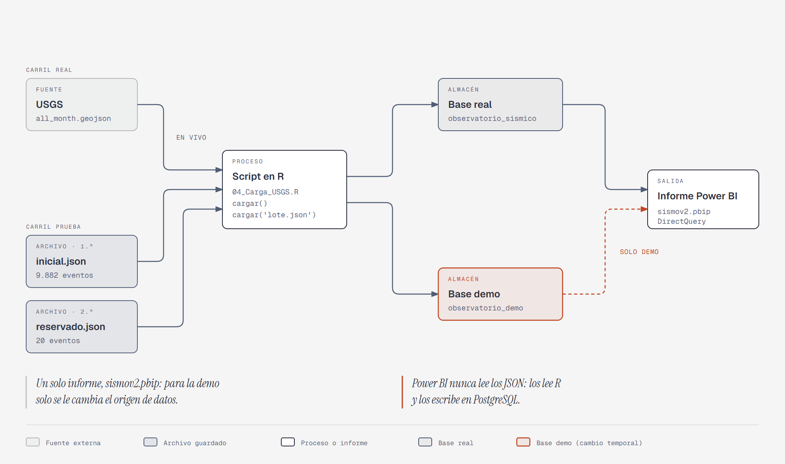

# Observatorio sísmico — Colombia en el panorama de América Latina

Práctica Profesional · Universidad del Valle · Escuela de Estadística · 2026-2
Flujo: **USGS → script R → PostgreSQL local → Power BI Desktop (DirectQuery)**

## 1. Integrantes

| Nombre                 | Código    |
| ---------------------- | --------- |
| José Julián Mosquera   | 202125444 |
| Santiago López Narváez | 202026342 |

Todos los integrantes pueden explicar el flujo completo.

## 2. Problema, usuario y preguntas

El usuario objetivo es un equipo de seguimiento sísmico interesado en Colombia, que necesita ubicar lo que registra el USGS en el país dentro del panorama de América Latina y el Caribe, explorar su distribución geográfica y temporal y conocer la actualidad de la información. El análisis es **descriptivo**: no es predicción ni alerta temprana.

Preguntas que responde el informe:

1. ¿Cuántos sismos y de qué magnitud registró el USGS en la región y qué lugar ocupa Colombia? (página *Panorama*)
2. ¿Cómo se comportan los sismos de Colombia, en frecuencia diaria, magnitud y profundidad, frente al resto de la región? (página *Análisis*)
3. ¿Qué tan actual y completa es la información cargada? (página *Calidad y Actualidad*)

**Datos y cobertura.** Los datos son los sismos de los últimos 30 días que publica el Servicio Geológico de EE. UU. (USGS) en un archivo abierto (`all_month.geojson`). Lo descargamos el 18 y el 20 de octubre de 2026 y guardamos solo los eventos de tipo `earthquake`. El informe cubre del 18 de septiembre al 20 de octubre (UTC), con 10.514 eventos. El país se toma del texto de `lugar`, y Colombia es el país de referencia.

## 3. Versiones utilizadas

| Componente | Versión |
|---|---|
| Windows | 11 Pro |
| PostgreSQL | 17.11 (x86_64, Windows) |
| pgAdmin 4 | 9.18 |
| R | 4.6.1 (2026-06-24, ucrt) |
| RStudio | 2026.10.0+233 |
| Paquetes R | DBI, RPostgres, jsonlite, httr2 (+ ggplot2, maps para el mapa) |
| Power BI Desktop | 2.159.883.0 |

## 4. Contenido del paquete

### 4.1 Material recibido en la actividad (sin modificar)

| Archivo                                                                           | Para qué sirve                                                                                                           |
| --------------------------------------------------------------------------------- | ------------------------------------------------------------------------------------------------------------------------ |
| `00_LEEME.txt`, `01_Guia_Actividad.md` / `.html`, `02_Instalacion_y_Ejecucion.md` | Guía de la actividad e instrucciones de instalación y ejecución                                                          |
| `03_Estructura.sql` (base)                                                        | Esquema `observatorio`, tablas `eventos` y `cargas`, vistas `v_eventos` y `v_cargas`, permisos de `pbi_lector`           |
| `04_Carga_USGS.R`                                                                 | Funciones `cargar()`, `preparar_demo()` y `continuar()`                                                                  |
| `05_Verificaciones.sql`                                                           | Consultas de control: conteo, ids únicos, faltantes y cargas                                                             |
| `datos_demo/`                                                                     | `inicial.json`, `reservado.json` y `procedencia.txt`: captura real del USGS (18 oct 2026) generada con `preparar_demo()` |

### 4.2 Aportes del grupo

| Archivo                          | Para qué sirve                                                                                                                                              |
| -------------------------------- | ----------------------------------------------------------------------------------------------------------------------------------------------------------- |
| `03_Estructura.sql` (ampliación) | Se añadió la tabla `paises_latam`, el catálogo que asigna el país a cada sismo                                                                              |
| `06_Vista_eventos_pais.sql`      | **Vista propia 1:** `v_eventos_pais`, con país, grupo (Colombia / resto de Latinoamérica / resto del mundo), intervalos de magnitud y tramos de profundidad |
| `07_Vistas_mcp.sql`              | **Vista propia 2:** `v_paises` y permisos de lectura                                                                                                        |
| `select.sql`                     | Consultas propias para construir y probar la clasificación por país                                                                                         |
| `carga.R`                        | **Orquestador de la carga en vivo:** define las variables de entorno, carga `04_Carga_USGS.R` y llama a `cargar()` sobre `observatorio_sismico`            |
| `10_Prueba_demo.R`               | **Orquestador de la prueba reproducible:** apunta a `observatorio_demo` y ejecuta, paso a paso y con verificaciones, la carga inicial, la del lote reservado y la repetición |
| `09_Base_demo.sql`               | Permisos de `pbi_lector` y verificaciones para la base `observatorio_demo` de la prueba reproducible                                                        |
| `Evidencia/`                     | Validación contra SQL (`validacion_sql.md`), guion de la prueba (`guion_prueba.md`) y capturas                                                              |
| `sismov2.pbip`                   | Informe de Power BI de tres páginas                                                                                                                         |
| `Medidas_DAX.md`                 | Medidas DAX del informe                                                                                                                                     |
| `diccionario_datos.txt`          | Diccionario de datos completo                                                                                                                               |
| `README.md`                      | Este documento                                                                                                                                              |

## 5. Cómo reproducirlo

No se incluye ninguna contraseña; cada equipo usa las suyas.

1. Instalar PostgreSQL (servidor y pgAdmin), R, RStudio y Power BI Desktop. Anotar la contraseña de `postgres` y el puerto (normalmente 5432).
2. En pgAdmin crear la base `observatorio_sismico`. En su Query Tool ejecutar, en orden: `03_Estructura.sql`, `06_Vista_eventos_pais.sql`, `07_Vistas_mcp.sql`.
3. Crear el rol `pbi_lector` (Can login, contraseña propia) y darle solo lectura: `CONNECT` sobre la base, `USAGE` sobre el esquema y `SELECT` sobre `v_eventos`, `v_cargas`, `v_eventos_pais` y `v_paises`. Cada vista nueva necesita su propio `GRANT SELECT`; sin él Power BI devuelve *permission denied*.
4. En RStudio abrir la carpeta como proyecto y, en la consola:
   ```r
   install.packages(c('DBI','RPostgres','jsonlite','httr2','rstudioapi'))
   Sys.setenv(PGUSER='postgres', PGDATABASE='observatorio_sismico', PGPORT='5432')
   Sys.setenv(PGPASSWORD=rstudioapi::askForPassword('Contraseña de PostgreSQL'))
   source('04_Carga_USGS.R')   # solo define funciones
   cargar()                    # una carga desde el USGS
   ```
5. Verificar con `05_Verificaciones.sql` (conteo, ids únicos, sin duplicados).
6. Abrir `sismov2.pbip` en Power BI Desktop, apuntar el origen a `localhost:5432` / `observatorio_sismico` con autenticación de base de datos (`pbi_lector`). Tablas en **DirectQuery**.
7. Cada página tiene **actualización automática de página con intervalo fijo de 1 minuto** (Formato de página → Actualización de página).
8. Modo continuo: `continuar(300)` (una carga cada 300 s; detener con Esc/Stop). Para ver cambios deben estar encendidos el PC, PostgreSQL, R y Power BI.

### Orden de ejecución de los scripts

**SQL** (los pasos 2 a 4 se repiten en cada base: `observatorio_sismico` y `observatorio_demo`):

| Orden | Archivo | Qué hace |
|---|---|---|
| 1 | *(pgAdmin)* | Crear la base y el rol `pbi_lector` |
| 2 | `03_Estructura.sql` | Esquema, tablas, `v_eventos`, `v_cargas` y `paises_latam` |
| 3 | `06_Vista_eventos_pais.sql` | Vista `v_eventos_pais` |
| 4 | `07_Vistas_mcp.sql` | Vista `v_paises` y permisos de lectura |
| 5 | `05_Verificaciones.sql` | Conteo, ids únicos, faltantes y cargas |
| 6 | `09_Base_demo.sql` | Solo en `observatorio_demo`: permisos de `pbi_lector` y verificaciones de la prueba |

**R:**

| Orden | Archivo | Qué hace |
|---|---|---|
| 1 | `04_Carga_USGS.R` | Define `cargar()`, `preparar_demo()` y `continuar()`; no carga nada por sí solo |
| 2 | `carga.R` | Carga en vivo sobre la base real |
| 3 | `10_Prueba_demo.R` | Prueba reproducible sobre la base demo |

### Prueba reproducible (base `observatorio_demo`)

El script de R carga datos del USGS en vivo en la base real, o los lotes guardados en la base demo. Power BI nunca lee los JSON: los lee R y los escribe en PostgreSQL, y Power BI consulta la base. Es un **único informe** (`sismov2.pbip`): para la demostración solo se le cambia el origen de datos a `observatorio_demo` y después se devuelve a `observatorio_sismico`.



Preparación:

1. Con el modo continuo detenido, crear en pgAdmin la base vacía `observatorio_demo` y ejecutar allí `03_Estructura.sql`, `06_Vista_eventos_pais.sql`, `07_Vistas_mcp.sql` y `09_Base_demo.sql`.
2. En Power BI: *Transformar datos → Configuración de origen de datos → Cambiar origen* a `observatorio_demo`, y quitar los filtros que oculten los eventos del lote reservado.
3. En RStudio, ejecutar `10_Prueba_demo.R` **línea por línea** (no con `source()`); cada paso trae el resultado esperado.

Qué se debe observar:

| Paso | Acción | Resultado |
|---|---|---|
| 1 | Base vacía | 0 eventos |
| 2 | `cargar('datos_demo/inicial.json')` | 9.882 eventos |
| 3 | `cargar('datos_demo/reservado.json')`; esperar el refresco de 1 minuto | 9.902 eventos, visibles en Power BI sin acción manual |
| 4 | Repetir exactamente la carga anterior | `afectados = 0`, sigue en 9.902 y sin duplicados |

Resultado del ensayo (24 oct 2026): las tres cargas quedaron registradas con `afectados` de 9.882, 20 y 0, y 9.902 eventos con 9.902 ids únicos. El detalle y las capturas están en `Evidencia/`.

No ejecutar `cargar()` sin archivo ni `continuar()` hasta terminar la prueba. Al finalizar, devolver el origen del informe a `observatorio_sismico`. Presentarla como reproducción controlada de datos reales con fechas originales conservadas (ver `datos_demo/procedencia.txt`: descarga 18 oct 2026 00:31 UTC).

## 6. Diccionario de datos (resumen)

Todas las fechas están en **UTC**. El diccionario completo está en `diccionario_datos.txt`.

| Campo | Tipo | Unidad | Faltantes / notas |
|---|---|---|---|
| `id` | text, clave primaria | — | Único; el script se detiene si falta. 0 duplicados |
| `fecha_evento` | timestamp UTC | — | Cuándo ocurrió el sismo |
| `actualizado_fuente` | timestamp UTC | — | Última revisión del USGS (no es la fecha del sismo) |
| `fecha_carga` | timestamp UTC | — | Cuándo se insertó/actualizó en la base (la asigna PostgreSQL) |
| `lugar` | text | — | Texto libre; de aquí se deduce el país |
| `magnitud` | double | adimensional (log) | Nunca se reemplaza por 0; las **negativas son válidas** |
| `tipo_magnitud` | text | — | `mb`, `md`, `ml`, `mww`, `mwr`, `mh`, `mb_lg`, `mw`; depende del método |
| `longitud`, `latitud` | double | grados | Categorizadas como coordenadas; no se suman |
| `profundidad_km` | double | km | Las **negativas son válidas** (ver abajo) |
| `url` | text | — | Enlace al evento en el USGS |

Campos derivados en `v_eventos_pais`: `fecha_dia` (día UTC), `pais`, `subregion`, `grupo` (*Colombia* / *Resto de Latinoamérica* / *Resto del mundo*), `intervalo_magnitud`, `tramo_profundidad` y sus columnas de orden.

**Las tres fechas no son lo mismo:** fecha del evento (cuándo ocurrió), `actualizado_fuente` (cuándo lo revisó el USGS) y `fecha_carga` (cuándo llegó a nuestra base). La tabla `cargas` describe ejecuciones del script y **no se relaciona** con los eventos.

**Valores negativos.** *Magnitud negativa*: la escala es logarítmica y sin mínimo; son microsismos (479 eventos, 4,6 %; mínimo −1,29). *Profundidad negativa*: la referencia es el nivel del mar o la elevación de las estaciones, así que un epicentro en terreno elevado o volcánico da profundidad negativa (219 eventos, 2,1 %; mínimo −3,4 km; ninguno de Colombia). Se conservan, y en los tramos de profundidad entran en «Menos de 10 km». Son fenómenos distintos y no se infiere uno del otro. Fuentes: USGS FAQs sobre [magnitud negativa](https://www.usgs.gov/faqs/how-can-earthquake-have-a-negative-magnitude) y [profundidad negativa](https://www.usgs.gov/faqs/what-does-it-mean-earthquake-occurred-a-depth-0-km-how-can-earthquake-have-a-negative-depth).

## 7. Definición de los indicadores

Período: por defecto todo el rango cargado (18 sep – 20 oct 2026 UTC). Los segmentadores de cada página permiten acotarlo, y los indicadores se recalculan con ese filtro. Las medidas están en `sismov2.SemanticModel` (ver `Medidas_DAX.md`).

| Indicador | Definición | Unidad | Faltantes | Decisión o tarea que apoya |
|---|---|---|---|---|
| Eventos | `DISTINCTCOUNT(id)` | eventos | `id` nunca falta | Dimensionar la actividad registrada en el período |
| Magnitud máxima | `MAX(magnitud)` | magnitud | Se ignoran vacíos; no se imputa 0 | Identificar el evento más fuerte que el equipo debe revisar |
| Último evento UTC | `MAX(fecha_evento)` | fecha-hora UTC | — | Saber qué tan reciente es el último sismo registrado |
| Eventos Colombia | Eventos con `grupo = "Colombia"` | eventos | — | Conocer la actividad del país de interés |
| % Colombia | Eventos Colombia ÷ Eventos | % | Vacío si el denominador es 0 | Ubicar el peso de Colombia frente a todo el catálogo |
| Eventos Latinoamérica | Eventos con `grupo <> "Resto del mundo"` | eventos | — | Definir el conjunto regional con el que se compara Colombia |
| % Colombia en Latinoamérica | Eventos Colombia ÷ Eventos Latinoamérica | % | Vacío si no hay eventos | Ubicar a Colombia dentro de la región |
| % sin magnitud / % sin profundidad | Eventos con el campo vacío ÷ Eventos | % | Se informa, no se imputa | Decidir si los resultados de magnitud y profundidad son confiables |
| Ids duplicados | `COUNTROWS − DISTINCTCOUNT(id)` | filas | Debe ser 0 | Detectar fallas de carga que inflen los conteos |
| Última carga exitosa UTC | `MAX(fin_utc)` con `estado = "ok"` | fecha-hora UTC | — | Decidir si los datos están al día o hay que revisar la carga |
| Cargas exitosas / fallidas | Filas de `v_cargas` con `estado` = / ≠ `"ok"` | cargas | — | Revisar si el proceso de carga está funcionando |

Las comparaciones entre países usan **magnitud ≥ 4,5**: el catálogo registra de forma desigual los sismos pequeños según la región, y comparar medias de grupos con distinto umbral de detección sería engañoso.

## 8. Validación: Power BI contra SQL

Consultas ejecutadas sobre `observatorio.v_eventos_pais` y `observatorio.v_cargas` el 20 oct 2026, sin filtros.

| Indicador | SQL | Power BI | ¿Coincide? |
|---|---|---|---|
| Eventos | 10.514 | 10.514 | Sí |
| Magnitud máxima | 7,7 | 7,7 | Sí |
| Último evento UTC | 20 oct 2026 21:38 | 20 oct 2026 21:38 | Sí |
| Eventos Colombia | 36 | 36 | Sí |
| % Colombia | 0,34 % | 0,34 % | Sí |
| Magnitud máx. Colombia | 4,8 | 4,8 | Sí |
| Eventos Latinoamérica | 292 | 292 | Sí |
| Ids duplicados | 0 | 0 | Sí |
| Sin magnitud / sin profundidad | 0 / 0 | 0 / 0 | Sí |
| Magnitud / profundidad negativa | 479 / 219 | 479 / 219 | Sí |
| Última carga ok UTC | 20 oct 2026 21:43 | 20 oct 2026 21:43 | Sí |

Estado de cargas: 2 ok, 2 con datos nuevos, 0 fallidas. Evidencia (capturas antes/después y resultados SQL) en la carpeta de evidencia del ZIP.

## 9. Tres hallazgos

Descriptivos, sobre el período cargado.

1. **Colombia ocupa el tercer lugar de la región en sismos de magnitud ≥ 4,5, pero lejos del primero.** Panamá lidera con 78 eventos (incluye el máximo del conjunto, M 7,7), Chile tiene 13 y Colombia 11, con un máximo de M 4,8. Colombia aporta 36 de los 292 eventos de la región (12,3 %) y 0,34 % de los 10.514 del mundo; el volumen global lo domina la microsismicidad de redes locales densas (Alaska, Hawái, California, etc.), no la actividad de la región.
2. **En Colombia todo evento registrado está entre M 4 y 5 (mediana 4,35); el resto de Latinoamérica sí registra sismos menores y mayores (hasta M 6 o más, 4 eventos).** Ausencia de microsismos en Colombia no equivale a ausencia de sismicidad: refleja el umbral de detección del catálogo USGS fuera de EE. UU. Por eso las comparaciones de magnitud se limitan a M ≥ 4,5.
3. **La profundidad es similar en ambos grupos (mediana 10 km), con más eventos intermedios en Colombia.** El 52,8 % de los sismos de Colombia está entre 10 y 35 km (59,4 % en el resto de la región), y el 11,1 % está entre 150 y 300 km (7,8 % en el resto). Colombia registra en promedio 1,89 eventos por día (mínimo 1, máximo 5; día pico 23 sep 2026).

## 10. Limitaciones

- **Ventana móvil de 30 días.** La base acumula los eventos consultados y no borra los que salen de la ventana; por eso los filtros temporales del informe son explícitos. El script **no reconcilia** eliminaciones ni fusiones del catálogo, ni revisiones de eventos que ya salieron de la ventana.
- **País por texto.** El país se deduce del final del campo `lugar` mediante `paises_latam`. Sismos en el mar abierto (dorsales, zonas oceánicas), dependencias no incluidas (Puerto Rico, Islas Vírgenes, Martinica, Anguila) quedan fuera de Latinoamérica. Se revisó que ningún país soberano de la región quede sin clasificar.
- **Tipos de magnitud mezclados.** Colombia usa casi solo `mb` (35 de 36); la región mezcla `mb`, `md`, `ml`, `mww` y `mwr`. La magnitud no es intensidad ni energía y las medianas entre grupos no son estrictamente comparables.
- **Cobertura desigual de sismos pequeños** entre regiones (ver hallazgo 2).
- **Rezago de carga no representativo.** La mediana `fecha_carga − fecha_evento` (≈ 16 días) es un artefacto de la primera carga, que trajo 30 días de historia de una vez; no mide la latencia real de la carga en vivo. La latencia real incluye la publicación del USGS, la carga y la consulta; no se promete inmediatez.
- **Mapa estático.** El mapa es un visual de R (imagen), sin interacción propia.
- **Local y solo Desktop.** Compartir el PBIX no comparte la base: otro equipo debe reconstruirla con los scripts y sus propias credenciales.
- Si falla la descarga, el tablero conserva los datos previos y la página *Calidad y Actualidad* lo muestra. `afectados = 0` no es un error: significa que no había nada nuevo.

## 11. Fuentes

- USGS, formato y feeds: <https://earthquake.usgs.gov/earthquakes/feed/v1.0/geojson.php>
- USGS, API del catálogo: <https://earthquake.usgs.gov/fdsnws/event/1/>
- Microsoft, conector PostgreSQL: <https://learn.microsoft.com/en-us/power-query/connectors/postgresql>
- Microsoft, actualización automática de página: <https://learn.microsoft.com/en-us/power-bi/create-reports/desktop-automatic-page-refresh>
